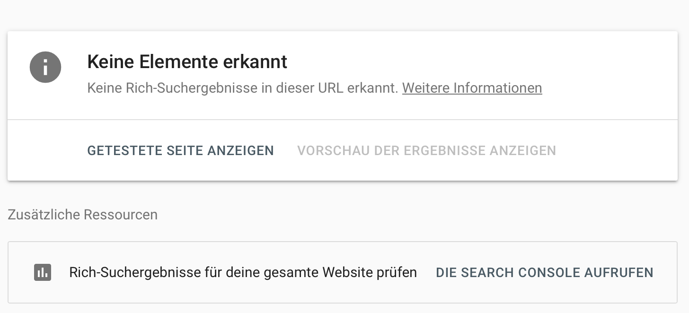

# Pokédex

Wir erstellen einen Pokédex mit einer öffentlichen API.

**Live:** https://github.com/julianroedger/webengineering_dhbw.git
**Team:** Julian Rödger, Alex Dortmann

## Ausgeschiedene Ideen

||Idee|Ausgeschieden, weil:|
|---|---|---|
|Rezept-Finder (TheMealDB)|Gerichte aufführen; Filterbar nach Zutaten, Kategorien oder Küchen.|Kochen ist für uns beide uninteresant, zudem ist diese Idee recht unkreativ.|
|Länder-Explorer (REST Countries)|Alle Länder, sortierbar nach Einwohnern, Fläche und Kontinent.|Langweilig und von wenig nutzen für den User.|
|Film-Watchlist (TMDB)|Filme suchen und eine eigene Merkliste anlegen.|Benötigt einen API-Key und Speicherlogik für die Merkliste -> viel höhere Komplexität.|
|Abfahrtsmonitor KA (KVV/EFA)|Abfahrten an Karlsruher Haltestellen, filterbar nach Linie.|Komplizierte (Wegen Live-Daten), schlecht dokumentierte API.|


## Was die App kann

- Anzeige der ersten 151 Pokémon
- Suche und Filter nach bspw. Typ, Attacken, Name

## Datenquelle

https://pokeapi.co

Welche API, welche Felder, wie oft aktualisiert? Link zur Doku.

## Lokal starten

In VS Code mit Live Server öffnen – oder:

```bash
npx serve .
```

## Technik

Womit gebaut und warum. Eine Zeile pro Entscheidung reicht, aber es soll eine Entscheidung sein, keine Aufzählung von Buzzwords.

## Rich Result Test 



## CSS-Kollision (Übungsblatt 3, A5)

- **Regeln:** `nav a { text-decoration: none }` und `nav a[aria-current="page"] { text-decoration: underline }` treffen beide den Link der aktuellen Seite.
- **Gewinner:** `nav a[aria-current="page"]`, der Link ist unterstrichen. In den DevTools ist `text-decoration: none` durchgestrichen.
- **Warum:** Spezifität (0,1,2) gegen (0,0,2). Der Attribut-Selektor zählt wie eine Klasse, die Reihenfolge im Stylesheet spielt keine Rolle.

## KI-Log

Ehrlich ausfüllen, das zählt zur Bewertung.

| Werkzeug | Wofür benutzt |
| --- | --- |
| Claude (Chat) | Ideenfindung |
| Claude | Überblick und Korrekturvorschläge der HTML-Semantik |

**Ein Fall, in dem KI geholfen hat:** Was habt ihr gefragt, was kam zurück, was habt ihr geändert?

**Ein Fall, in dem KI falsch lag:** Woran habt ihr es gemerkt, wie habt ihr es gelöst?
